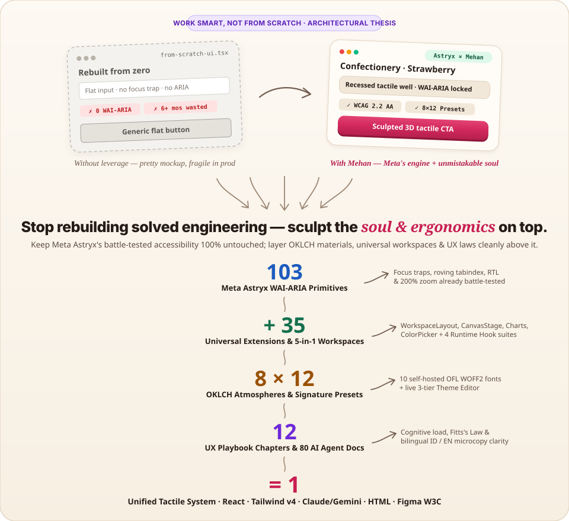
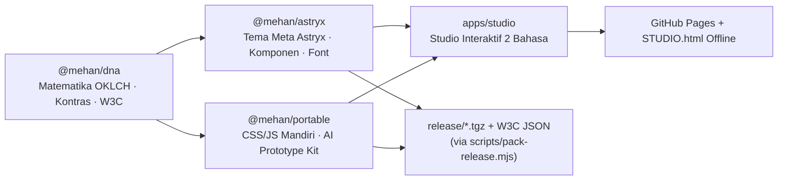

<div align="center">
  <picture>
    <source media="(prefers-color-scheme: dark)" srcset="./assets/readme-header-dark.svg" />
    <source media="(prefers-color-scheme: light)" srcset="./assets/readme-header-light.svg" />
    
  </picture>

  <p>
    <a href="./README.md">← English</a> · <strong>Bahasa Indonesia</strong>
    &nbsp;|&nbsp;
    <a href="https://alamehan.github.io/mehan-design-system/">Buka Web Studio</a> ·
    <a href="./STUDIO.html">STUDIO.html Offline</a> ·
    <a href="./docs/DESIGN-SYSTEM-REPLICATION-PLAYBOOK.md">Panduan Replikasi DS</a> ·
    <a href="./LICENSE">Lisensi MIT</a>
  </p>
</div>

> [!TIP]
> **Mehan Design System** memadukan fondasi aksesibilitas keyboard dan komponen tangguh **[Meta Astryx](https://astryx.atmeta.com)** dengan karakter visual hangat & taktil karya **[M. Raihan Rafiiful Allaam (`@alamehan`)](https://alamehan.github.io)** — langsung siap dipakai dalam satu klik untuk **React / Next.js / Tailwind CSS v4**, **prototipe AI di Claude & Gemini**, **Vanilla HTML / Vue / Svelte**, hingga **token desain Figma W3C**.

| Tujuanmu | Mulai dari Sini |
|---|---|
| **Mencoba tema, komponen & contoh layar aplikasi tanpa instalasi** | Buka **[alamehan.github.io/mehan-design-system](https://alamehan.github.io/mehan-design-system/)** *(atau klik dua kali **[`STUDIO.html`](./STUDIO.html)** secara offline)* |
| **Membuat prototipe aplikasi utuh lewat chat Claude, Gemini, atau ChatGPT** | Klik **`Salin AI Kit`** di dalam Studio *(atau salin isi [`release/MEHAN-AI-PROTOTYPE-KIT.md`](./release/MEHAN-AI-PROTOTYPE-KIT.md))* |
| **Memasang di proyek React, Next.js, atau Tailwind CSS v4** | Lompat ke **[Mulai dalam 60 Detik](#mulai-dalam-60-detik)** atau klik **`Salin Setup Prompt`** di Studio |
| **Memakai tanpa React (Vanilla HTML, Vue, Svelte, Astro, atau Figma)** | Ambil [`mehan-portable.css`](./release/mehan-portable.css), [`mehan-portable.js`](./release/mehan-portable.js), atau [`mehan-tokens.w3c.json`](./release/mehan-tokens.w3c.json) dari folder [`release/`](./release) |
| **Membangun Design System lain (HRIS, PM, SaaS) dengan standar serupa** | Baca **[`docs/DESIGN-SYSTEM-REPLICATION-PLAYBOOK.md`](./docs/DESIGN-SYSTEM-REPLICATION-PLAYBOOK.md)** |
| **Berkontribusi atau menjalankan AI coding agent di repositori ini** | Baca **[`AGENTS.md`](./AGENTS.md)** dan **[`CLAUDE.md`](./CLAUDE.md)** |

---

## Kenapa Mehan Dibuat — Fondasi Cerdas, Sentuhan Desain Penuh Dedikasi

Banyak tim membangun design system dari nol — atau membeli UI kit statis — demi mendapatkan tampilan yang segar, namun akhirnya menghabiskan berbulan-bulan mengulang pembuatan tombol, dropdown, dan modal yang tampak rapi di gambar mockup tetapi bermasalah saat dipakai nyata: navigasi keyboard macet, fokus modal lepas, tampilan HP meluber, dan kontras mode gelap yang kabur.

**Mehan Design System** mengambil langkah rekayasa dan Product Design yang jauh lebih cerdas:



1. **Berdiri di Atas Mesin Aksesibilitas Teruji ([Meta Astryx](https://astryx.atmeta.com) · [`meta/astryx`](https://github.com/meta/astryx)):** Astryx adalah design system open-source resmi dari Meta yang telah teruji di ribuan aplikasi produksi serta dirancang untuk developer React maupun AI coding agent (`@astryxdesign/core` & `@astryxdesign/cli`). Mehan menjaga 100% mesin dasar tersebut tetap utuh tanpa memodifikasi liar satu pun komponen intinya.
2. **Mencurahkan 100% Karya Orisinal pada Rasa & Pengalaman Produk (`@mehan/dna` + `@mehan/astryx`):** Dirancang dari hulu ke hilir dengan mesin matematika warna OKLCH & penguji kontras WCAG 2.2 AA, permukaan kertas hangat & tombol taktil 3D, koleksi font open-source yang tertanam offline, proporsi ukuran seragam lintas komponen (`sm: 30px`, `md: 36px`, `lg: 42px`), tata letak ruang kerja adaptif, serta panduan penulisan UX 2 bahasa (`ID`/`EN`).
3. **Satu Tema untuk Segala Platform Tanpa Terkunci (`@mehan/portable`):** Setiap tema yang kamu racik di Studio dapat diekspor serentak ke React/StyleX, Tailwind CSS v4, CSS/JS mandiri `.mh-*`, AI Prototype Kit satu prompt, dan token W3C simetris Terang/Gelap untuk Figma.

---

## Mulai dalam 60 Detik

Kamu **tidak** perlu membuka terminal untuk menjelajahi, mengatur tampilan, atau memakai Mehan:

1. **Buka Studio Interaktif:** Kunjungi **[alamehan.github.io/mehan-design-system](https://alamehan.github.io/mehan-design-system/)** *(atau unduh repo ini lalu klik dua kali [`STUDIO.html`](./STUDIO.html) tanpa koneksi internet)*.
2. **Pilih atau Racik Karakter Visualmu:** Klik salah satu preset siap pakai langsung di halaman `Ringkasan`, atau tekan `Ctrl/⌘ + .` untuk membuka **`Editor Tema`** dan menyesuaikan atmosfer permukaan, warna merek, font, serta kelengkungan sudut secara langsung di mode Terang & Gelap.
3. **Salin Output Sesuai Kebutuhanmu:**
   - **Prototipe di Chat AI (Claude / Gemini / ChatGPT / v0):** Klik **`Salin AI Kit`** → tempel ke chat AI bersama ide aplikasimu → dapatkan aplikasi satu file HTML utuh berstandar Mehan.
   - **Aplikasi Produksi React, Next.js, atau Vite:** Klik **`Salin Setup Prompt`** untuk AI coding agent-mu, atau pasang langsung lewat terminal *(otomatis mengunduh mesin `@astryxdesign/core` dari gudang resmi `npm` + paket `@mehan/astryx` langsung dari folder [`release/`](./release) repo ini)*:
     ```bash
     pnpm add @astryxdesign/core@~0.7.17 @stylexjs/stylex@^0.19.0 lucide-react "https://github.com/alamehan/mehan-design-system/raw/main/release/mehan-astryx-1.0.0.tgz"
     pnpm add -D @astryxdesign/cli@~0.7.17 && pnpm exec astryx init --features agents
     ```
     *(Atau buat otomatis `src/mehan.css` + `src/MehanProvider.tsx` dari file JSON hasil ekspor Studio: `node ./bin/mehan.mjs init ./my-app --from mehan-confectionery-theme.json --github`.)*
   - **Vanilla HTML, Vue, Svelte, Astro, atau Figma:** Klik **`Salin CSS Portable`**, **`Unduh Starter HTML`**, atau **`Token W3C Figma`**, atau ambil file jadinya langsung dari [`release/`](./release).

---

## Kemampuan Unggulan

- **Mesin Warna Perseptual OKLCH & Jaminan Kontras WCAG 2.2 AA (`@mehan/dna`):** Menghitung 7 lapis kedalaman permukaan Terang & Gelap (`socket < well < paper < tray < surface < raised < float`), gradasi tombol 3-titik yang lembut, bibir bawah tombol 3D yang selaras, serta pengecekan kontras AA otomatis baik untuk warna bawaan maupun kode `#rrggbb` kustom pilihanmu.
- **Proporsi Ukuran & Tipografi Seragam Lintas Komponen:** Menjaga keselarasan sudut bertingkat (`7px` dalam → `10px` kontrol → `16px` kartu → `24px` dialog) serta tinggi dan ukuran teks yang konsisten antara tombol, kolom input, dropdown, tab segmen, hingga kontrol kustom Mehan.
- **Komponen Ruang Kerja, Kreatif & Visualisasi Data (`@mehan/astryx`):** Melengkapi komponen inti Meta Astryx dengan `WorkspaceLayout`, `CanvasStage`, `PropertyRow`, `DataChart` (lengkap dengan tabel pembaca layar), `ColorPicker`, `GradientPicker`, `CodeEditor`, `MarkdownEditor`, `ColumnView`, `ShortcutSheet`, serta hook siap pakai (`useMehanShortcuts`, `useAutoDraft`, `useUnsavedGuard`).
- **Koleksi Font Open-Source Tertanam Offline:** Menyertakan langsung file font `.woff2` berlisensi terbuka (`Bricolage Grotesque`, `Figtree`, `Fraunces`, `Outfit`, `Albert Sans`, `Poppins`, `Montserrat`, `Crimson Text`, `Geist Mono`, `JetBrains Mono`) sehingga tampilan tetap tajam tanpa bergantung pada jaringan luar.
- **Panduan UX & Penulisan Antarmuka 2 Bahasa (`ID`/`EN`):** Dilengkapi panduan praktis menyusun antarmuka yang tenang, penanganan status kosong/gagal yang ramah manusia, ergonomi pintasan keyboard, dan penulisan teks tombol yang lugas — terbaca baik di dalam Studio maupun oleh AI coding agent lewat `astryx docs`.

### Pilihan Tema Siap Pakai

| Tema | Karakter | Atmosfer | Tipografi (Judul / Isi) | Nuansa Visual |
|---|---|---|---|---|
| **Confectionery** *(Bawaan)* | Identitas Utama | `confectionery` | `Bricolage Grotesque` / `Figtree` | Kertas krem hangat & tombol 3D merah beri yang ramah |
| **Espresso Berry** | Taktil Ringkas | `confectionery` | `Bricolage Grotesque` / `Figtree` | Ukuran padat `32px` & penanda tab espresso tegas |
| **Sunlit Butter** | Cerah & Hangat | `butter` | `Outfit` / `Outfit` | Kanvas kuning mentega lembut & aksen biru kobalt tajam |
| **Kyoto Matcha** | Tenang & Organik | `matcha` | `Bricolage Grotesque` / `Figtree` | Permukaan hijau teh lembut & mode gelap lumut teduh |
| **Artisanal Cacao** | Editorial Serif | `cacao` | `Fraunces` / `Albert Sans` | Nuansa oat hangat, cokelat sangrai & tipografi serif |
| **Cloud Y2K Pop** | Ekspresif & Lembut | `periwinkle` | `Poppins` / `Poppins` | Ungu pastel sejuk dengan sudut membulat yang ceria |
| **Obsidian Linear** | Presisi Teknis | `obsidian` | `Albert Sans` / `JetBrains Mono` | Abu titanium & hitam karbon dengan sudut tegas `0.75x` |
| **Porcelain SaaS** | Bisnis Bersih | `porcelain` | `Albert Sans` / `Figtree` | Putih porselen jernih & biru klasik untuk aplikasi data |
| **Stone Editorial** | Ruang Baca Tenang | `stone` | `Fraunces` / `Figtree` | Batu pasir hangat & hijau toska teduh untuk alat AI/tulis |
| **Solar Citrus** | Studio Kreatif | `butter` | `Bricolage Grotesque` / `Outfit` | Kanvas keemasan berpadu aksen jeruk mandarin segar |
| **Nordic Fjord** | Analitik Tajam | `porcelain` | `Montserrat` / `Figtree` | Kejernihan tinggi berpadu biru kehijauan fjord |
| **Velvet Crimson** | Berani & Klasik | `stone` | `Fraunces` / `Figtree` | Permukaan batu lembut dengan kontras merah rubi pekat |

---

## Peta Arsitektur & Struktur Folder



| Jalur | Peran |
|---|---|
| [`packages/dna`](./packages/dna) | `@mehan/dna` — Mesin murni matematika OKLCH, atmosfer, aksen, penguji kontras WCAG 2.2 AA, riwayat undo/redo, pemformat `Intl`, validator file, dan pengekspor token W3C. |
| [`packages/astryx`](./packages/astryx) | `@mehan/astryx` — Penyedia tema resmi Meta Astryx (`createMehanTheme`), tema siap pakai, komponen ruang kerja & kreatif, runtime hooks, font offline WOFF2, dan dokumentasi AI agent. |
| [`packages/portable`](./packages/portable) | `@mehan/portable` — Generator CSS mandiri `.mh-*`, runtime JS ringan, pembuat AI Prototype Kit, dan starter HTML tanpa bundler. |
| [`apps/studio`](./apps/studio) | `@mehan/studio` — Aplikasi Studio interaktif (`ID`/`EN`) yang tertata rapi dalam `components/`, `views/`, `catalog/`, `templates/`, dan `theme-editor/`. |
| [`bin/mehan.mjs`](./bin/mehan.mjs) | CLI lintas sistem operasi untuk inisialisasi proyek & ekspor token (`init`, `tokens`, `ai-kit`, `set-scope`). |
| [`scripts/`](./scripts) | Orkestrator rilis [`pack-release.mjs`](./scripts/pack-release.mjs) beserta skrip jalan pintas satu klik untuk Windows (`.cmd`) dan macOS/Linux (`.command`). |
| [`release/`](./release) | Paket siap pasang (`mehan-dna-1.0.0.tgz`, `mehan-astryx-1.0.0.tgz`, `mehan-portable-1.0.0.tgz`), CSS/JS Portable, AI Kit, HTML CDN, dan token W3C. |
| [`docs/`](./docs) | Dokumentasi arsitektur termasuk **[`DESIGN-SYSTEM-REPLICATION-PLAYBOOK.md`](./docs/DESIGN-SYSTEM-REPLICATION-PLAYBOOK.md)** sebagai panduan membuat Design System saudara (HRIS, PM, Enterprise SaaS). |
| [`tests/`](./tests) | Terpisah rapi menjadi [`tests/unit/`](./tests/unit) (pembuktian matematika, CLI & kerapian repo via Vitest) dan [`tests/e2e/`](./tests/e2e) (tes visual browser & aksesibilitas `axe` via Playwright). |

Jalankan `pnpm install && pnpm verify` *(atau klik dua kali [`scripts/verify-windows.cmd`](./scripts/verify-windows.cmd) / [`scripts/verify-mac-linux.command`](./scripts/verify-mac-linux.command))* untuk mengeksekusi seluruh 6 gerbang pemeriksaan kualitas secara otomatis.

---

<details>
<summary><strong>Ruang Lingkup, Pertimbangan Desain &amp; Batasan</strong></summary>

- **Versi Mesin Dikunci Aman (`@astryxdesign/core ~0.7.17`):** Mehan sengaja mengunci versi Meta Astryx yang sudah teruji alih-alih mengikuti versi `latest` secara buta, sehingga pembaruan luar tidak akan pernah merusak perilaku fokus keyboard atau tampilan komponen secara tiba-tiba. Pembaruan versi Astryx dilakukan terukur melalui pemeriksaan `pnpm verify`.
- **Nol Modifikasi Liar pada Komponen Inti:** Komponen standar (`Button`, `Dialog`, `Selector`, `Table`, `Tabs`) diatur sepenuhnya melalui jalur token resmi Astryx (`createMehanTheme.ts`), bukan dengan menduplikasi ulang kodenya.
- **Pisahkan Repo untuk Karakter Industri yang Berbeda Jauh:** Mehan dirancang khusus untuk aplikasi web modern yang hangat, alat kreatif, dan ruang kerja AI. Untuk sistem perusahaan padat data dengan gaya visual dan komponen khusus industri yang sangat berbeda (seperti HRIS, Project Management, atau ERP), gunakan cetak biru di [`docs/DESIGN-SYSTEM-REPLICATION-PLAYBOOK.md`](./docs/DESIGN-SYSTEM-REPLICATION-PLAYBOOK.md) untuk membangun repo Design System mandiri di atas standar mesin yang sama.

</details>

---

## Pembuat & Lisensi

Dirancang dan dibangun sepenuh hati oleh **[M. Raihan Rafiiful Allaam (`@alamehan`)](https://alamehan.github.io)** — *Product Designer & Product Engineer*.

Lisensi MIT — lihat [LICENSE](./LICENSE) dan [THIRD_PARTY_NOTICES.md](./THIRD_PARTY_NOTICES.md).
