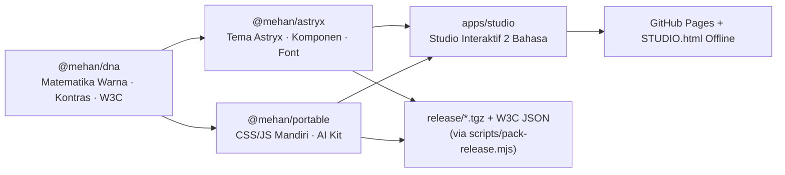

<div align="center">
  <picture>
    <source media="(prefers-color-scheme: dark)" srcset="./assets/readme-header-dark.svg" />
    <source media="(prefers-color-scheme: light)" srcset="./assets/readme-header-light.svg" />
    
  </picture>

  <p>
    <a href="./README.md">← English</a> · <strong>Bahasa Indonesia</strong>
    &nbsp;&nbsp;·&nbsp;&nbsp;
    <a href="https://alamehan.github.io/mehan-design-system/"><strong>✨ Buka Live Studio</strong></a> ·
    <a href="./STUDIO.html">STUDIO.html Offline</a> ·
    <a href="./LICENSE">Lisensi MIT</a>
  </p>
</div>

---

## Kenapa Mehan Design System Dibuat

Saat membangun aplikasi digital modern, banyak tim terjebak di antara dua pilihan sulit: menghabiskan berbulan-bulan merakit tombol, menu dropdown, dan jendela dialog dari nol — yang tampak cantik di gambar desain tetapi sering bermasalah saat dipakai lewat keyboard, layar HP, atau mode gelap — atau memakai komponen instan yang terasa kaku, dingin, dan seragam dengan produk lain.

**Mehan Design System** mengambil langkah yang jauh lebih cerdas dan penuh dedikasi. Di balik layar, Mehan berdiri di atas **[Meta Astryx](https://astryx.atmeta.com)** — mesin komponen open-source milik Meta yang sudah teruji — sehingga keandalan fungsi dan aksesibilitasnya langsung beres sejak hari pertama. Di atas fondasi kokoh itu, **100% sentuhan Product Design dan Engineering** dicurahkan pada *bagaimana produk terasa saat disentuh manusia*: permukaan sehangat kertas, tombol taktil yang mantap ditekan, ukuran yang selaras di semua komponen, 12 suasana warna siap pakai, serta panduan penulisan UX 2 bahasa (`ID`/`EN`) yang membumi.

---

## Langsung Coba Sekarang (Tanpa Instalasi)

| Apa yang ingin kamu lakukan | Buka bagian ini |
|---|---|
| **Menjelajahi 12 tema visual, komponen interaktif & contoh halaman utuh** | Kunjungi **[alamehan.github.io/mehan-design-system](https://alamehan.github.io/mehan-design-system/)** |
| **Membuka aplikasi Studio secara penuh tanpa koneksi internet** | Unduh lalu klik dua kali file **[`STUDIO.html`](./STUDIO.html)** |
| **Mengubah ide aplikasi menjadi prototipe jadi lewat chat Claude, Gemini, atau ChatGPT** | Buka Studio → klik **`Salin AI Kit`** *(atau salin isi [`MEHAN-AI-PROTOTYPE-KIT.md`](./release/MEHAN-AI-PROTOTYPE-KIT.md))* |
| **Membangun Design System lain (HRIS, PM, SaaS) dengan standar mesin serupa** | Baca panduan lengkap **[Replication Playbook](./docs/DESIGN-SYSTEM-REPLICATION-PLAYBOOK.md)** |

---

## Keunggulan Utama

- **12 Suasana Visual Siap Pakai & Nyaman Dibaca:** Ganti nuansa dengan mudah mulai dari *Confectionery* yang hangat dan *Kyoto Matcha* yang teduh hingga *Porcelain SaaS* atau *Obsidian Linear* yang tegas — setiap perpaduan warna terang dan gelapnya dijaga otomatis agar teks selalu jernih terbaca.
- **Proporsi Rapi & Seragam di Semua Kontrol:** Tombol, kolom input, pilihan dropdown, tab segmen, hingga kontrol kustom memiliki tinggi, lengkung sudut, dan ukuran huruf yang selaras sehingga antarmuka selalu terlihat tenang dan presisi.
- **Komponen Ruang Kerja & Alat Kreatif Siap Pakai:** Selain komponen dasar, tersedia tata letak aplikasi multi-panel, kanvas kerja interaktif, grafik data, pemilih warna & gradasi, editor kode/markdown, serta penyimpan draf formulir otomatis.
- **Racik Langsung, Pakai di Mana Saja:** Sesuaikan warna merek, koleksi font open-source bawaan, dan kelengkungan sudut langsung di **`Theme Editor`**, lalu ekspor dalam satu klik ke **React / Tailwind**, **HTML Murni**, **Chat AI**, maupun **Figma**.
- **Panduan UX & Bahasa Antarmuka yang Manusiawi:** Dilengkapi 12 bab panduan praktis (`ID`/`EN`) untuk merancang alur halaman yang tidak membingungkan, pesan error yang membantu, dan kalimat tombol yang jelas.

---

## Detail Teknis & Panduan Developer

<details>
<summary><strong>🛠️ Quickstart, Instalasi React / Tailwind &amp; Perintah CLI</strong></summary>

### 1. Aplikasi React, Next.js, atau Vite (`@mehan/astryx` + `@astryxdesign/core`)
Pasang mesin dasar Meta Astryx dari `npm` bersama paket rilis Mehan dari repositori ini:

```bash
pnpm add @astryxdesign/core@~0.7.17 @stylexjs/stylex@^0.19.0 lucide-react "https://github.com/alamehan/mehan-design-system/raw/main/release/mehan-astryx-1.0.0.tgz"
pnpm add -D @astryxdesign/cli@~0.7.17 && pnpm exec astryx init --features agents
```

Atau buat otomatis file `src/mehan.css` dan `src/MehanProvider.tsx` dari JSON tema hasil ekspor Studio:

```bash
node ./bin/mehan.mjs init ./my-app --from mehan-confectionery-theme.json --github
```

### 2. Vanilla HTML, Vue, Svelte, Astro, atau Figma (Tanpa React)
Ambil langsung file mandiri siap pakai dari folder [`release/`](./release) (atau ekspor versi kustommu lewat Studio):
- **CSS & JS Mandiri:** [`mehan-portable.css`](./release/mehan-portable.css) + [`mehan-portable.js`](./release/mehan-portable.js)
- **AI Prototype Kit Satu Prompt:** [`MEHAN-AI-PROTOTYPE-KIT.md`](./release/MEHAN-AI-PROTOTYPE-KIT.md)
- **Token Desain W3C Figma:** [`mehan-tokens.w3c.json`](./release/mehan-tokens.w3c.json)

</details>

<details>
<summary><strong>🎨 Daftar 12 Tema, Peta Arsitektur &amp; Struktur Folder</strong></summary>

### Daftar Tema Siap Pakai

| Tema | Karakter | Atmosfer | Font Judul / Isi | Nuansa Visual |
|---|---|---|---|---|
| **Confectionery** *(Bawaan)* | Identitas Utama | `confectionery` | `Bricolage Grotesque` / `Figtree` | Kertas krem hangat & tombol 3D merah beri yang ramah |
| **Espresso Berry** | Taktil Ringkas | `confectionery` | `Bricolage Grotesque` / `Figtree` | Ukuran padat `32px` & penanda tab espresso tegas |
| **Sunlit Butter** | Cerah & Hangat | `butter` | `Outfit` / `Outfit` | Kanvas kuning mentega lembut & aksen biru kobalt tajam |
| **Kyoto Matcha** | Tenang & Organik | `matcha` | `Bricolage Grotesque` / `Figtree` | Permukaan hijau teh lembut & mode gelap lumut teduh |
| **Artisanal Cacao** | Editorial Serif | `cacao` | `Fraunces` / `Albert Sans` | Nuansa oat hangat, cokelat sangrai & tipografi serif |
| **Cloud Y2K Pop** | Ekspresif & Lembut | `periwinkle` | `Poppins` / `Poppins` | Ungu pastel sejuk dengan sudut membulat yang ceria |
| **Obsidian Linear** | Presisi Teknis | `obsidian` | `Albert Sans` / `JetBrains Mono` | Abu titanium & hitam karbon dengan sudut tegas |
| **Porcelain SaaS** | Bisnis Bersih | `porcelain` | `Albert Sans` / `Figtree` | Putih porselen jernih & biru klasik untuk aplikasi data |
| **Stone Editorial** | Ruang Baca Tenang | `stone` | `Fraunces` / `Figtree` | Batu pasir hangat & hijau toska teduh untuk alat AI/tulis |
| **Solar Citrus** | Studio Kreatif | `butter` | `Bricolage Grotesque` / `Outfit` | Kanvas keemasan berpadu aksen jeruk mandarin segar |
| **Nordic Fjord** | Analitik Tajam | `porcelain` | `Montserrat` / `Figtree` | Kejernihan tinggi berpadu biru kehijauan fjord |
| **Velvet Crimson** | Berani & Klasik | `stone` | `Fraunces` / `Figtree` | Permukaan batu lembut dengan kontras merah rubi pekat |

### Arsitektur Monorepo



| Jalur | Peran |
|---|---|
| [`packages/dna`](./packages/dna) | `@mehan/dna` — Mesin warna perseptual OKLCH, atmosfer, aksen, penguji kontras WCAG 2.2 AA, riwayat undo/redo, pemformat `Intl`, dan pengekspor token W3C. |
| [`packages/astryx`](./packages/astryx) | `@mehan/astryx` — Penyedia tema resmi Meta Astryx (`createMehanTheme`), tema siap pakai, komponen ruang kerja & kreatif, runtime hooks, font offline WOFF2, dan dokumentasi AI agent. |
| [`packages/portable`](./packages/portable) | `@mehan/portable` — Generator CSS mandiri `.mh-*`, runtime JS ringan, pembuat AI Prototype Kit, dan starter HTML tanpa bundler. |
| [`apps/studio`](./apps/studio) | `@mehan/studio` — Aplikasi Studio interaktif (`ID`/`EN`) yang tertata dalam `components/`, `views/`, `catalog/`, `templates/`, dan `theme-editor/`. |
| [`bin/mehan.mjs`](./bin/mehan.mjs) | CLI lintas sistem operasi untuk inisialisasi proyek & ekspor token (`init`, `tokens`, `ai-kit`, `set-scope`). |
| [`scripts/`](./scripts) | Orkestrator rilis [`pack-release.mjs`](./scripts/pack-release.mjs) serta skrip jalan pintas satu klik untuk Windows (`.cmd`) dan macOS/Linux (`.command`). |
| [`release/`](./release) | Paket siap pasang (`mehan-dna-1.0.0.tgz`, `mehan-astryx-1.0.0.tgz`, `mehan-portable-1.0.0.tgz`), CSS/JS Portable, AI Kit, HTML CDN, dan token W3C. |
| [`docs/`](./docs) | **[`DESIGN-SYSTEM-REPLICATION-PLAYBOOK.md`](./docs/DESIGN-SYSTEM-REPLICATION-PLAYBOOK.md)** — Cetak biru lengkap membangun Design System saudara. |
| [`tests/`](./tests) | [`tests/unit/`](./tests/unit) (tes matematika warna, CLI & kerapian repo via Vitest) dan [`tests/e2e/`](./tests/e2e) (tes visual browser & aksesibilitas `axe` via Playwright). |

Jalankan `pnpm install && pnpm verify` *(atau klik dua kali [`scripts/verify-windows.cmd`](./scripts/verify-windows.cmd) / [`scripts/verify-mac-linux.command`](./scripts/verify-mac-linux.command))* untuk menjalankan seluruh 6 gerbang pemeriksaan kualitas.

</details>

<details>
<summary><strong>🧭 Batasan Desain, Stabilitas Versi &amp; Panduan Replikasi</strong></summary>

- **Versi Mesin Dikunci Aman (`@astryxdesign/core ~0.7.17`):** Versi dikunci sengaja agar pembaruan luar tidak pernah mengubah perilaku fokus keyboard atau tampilan secara diam-diam; pembaruan diuji terukur lewat `pnpm verify`.
- **Komponen Inti Tetap Murni:** Komponen dasar (`Button`, `Dialog`, `Selector`, `Table`, `Tabs`) tetap menggunakan komponen asli Meta Astryx yang diatur lewat jalur tema resmi (`createMehanTheme.ts`).
- **Pisahkan Repo untuk Karakter Industri yang Berbeda:** Mehan dirancang untuk aplikasi web hangat, studio kreatif, dan ruang kerja AI. Untuk sistem perusahaan padat data seperti **HRIS**, **Project Management**, atau **ERP**, ikuti panduan langkah demi langkah di **[`docs/DESIGN-SYSTEM-REPLICATION-PLAYBOOK.md`](./docs/DESIGN-SYSTEM-REPLICATION-PLAYBOOK.md)** bersama [`AGENTS.md`](./AGENTS.md) dan [`CLAUDE.md`](./CLAUDE.md).

</details>

---

Dirancang dan dibangun sepenuh hati oleh **[M. Raihan Rafiiful Allaam (`@alamehan`)](https://alamehan.github.io)** — *Product Designer & Product Engineer*. Dirilis di bawah [Lisensi MIT](./LICENSE) (lihat [`THIRD_PARTY_NOTICES.md`](./THIRD_PARTY_NOTICES.md)).
