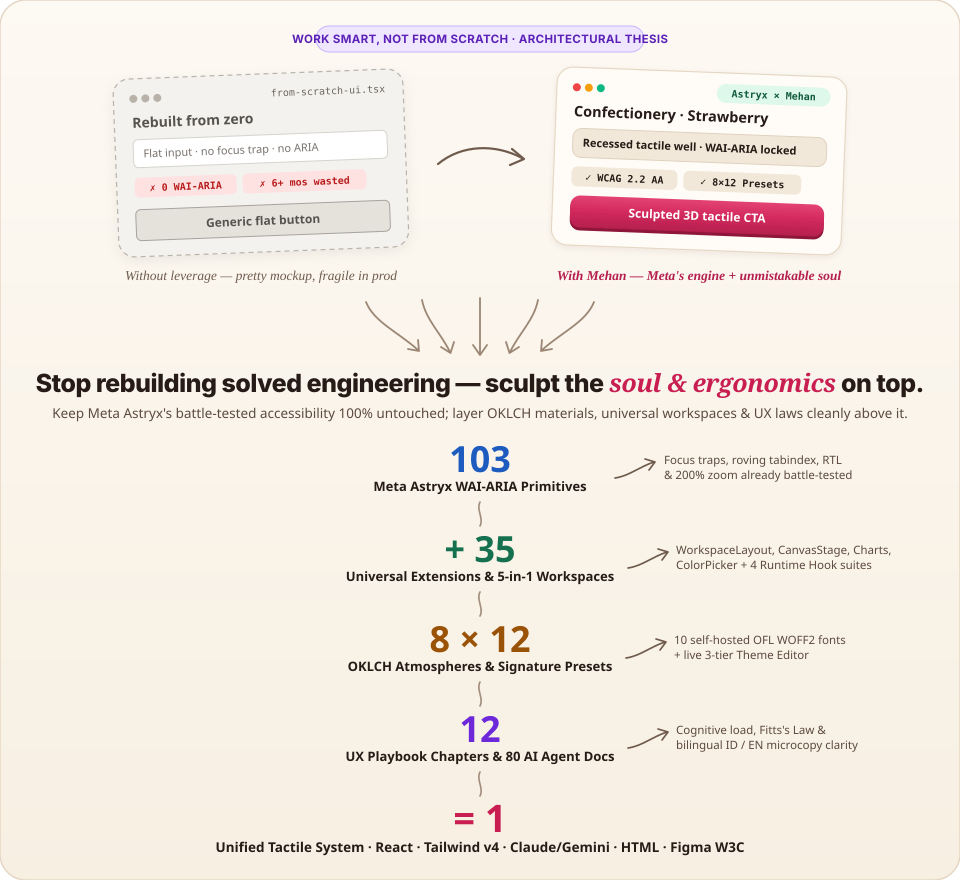
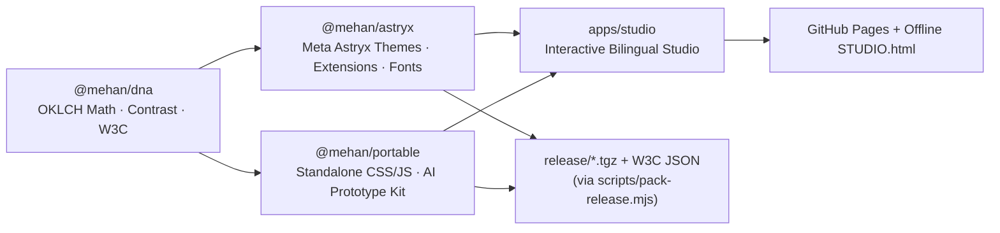

<div align="center">
  <picture>
    <source media="(prefers-color-scheme: dark)" srcset="./assets/readme-header-dark.svg" />
    <source media="(prefers-color-scheme: light)" srcset="./assets/readme-header-light.svg" />
    
  </picture>

  <p>
    <strong>English</strong> · <a href="./README.id.md">Bahasa Indonesia →</a>
    &nbsp;|&nbsp;
    <a href="https://alamehan.github.io/mehan-design-system/">Live Web Studio</a> ·
    <a href="./STUDIO.html">Offline STUDIO.html</a> ·
    <a href="./docs/DESIGN-SYSTEM-REPLICATION-PLAYBOOK.md">Replication Playbook</a> ·
    <a href="./LICENSE">MIT License</a>
  </p>
</div>

> [!TIP]
> **Mehan Design System** pairs the battle-tested keyboard accessibility and component mechanics of **[Meta Astryx](https://astryx.atmeta.com)** with an original warm, tactile visual DNA crafted by **[M. Raihan Rafiiful Allaam (`@alamehan`)](https://alamehan.github.io)** — ready in one click for **React / Next.js / Tailwind CSS v4**, **Claude & Gemini AI Prototyping**, **Vanilla HTML / Vue / Svelte**, and **Figma W3C Design Tokens**.

| Your Goal | Start Here |
|---|---|
| **Explore themes, components & full-screen workspaces instantly** | Open **[alamehan.github.io/mehan-design-system](https://alamehan.github.io/mehan-design-system/)** *(or double-click **[`STUDIO.html`](./STUDIO.html)** offline — zero install)* |
| **Prototype a complete app inside Claude, Gemini, or ChatGPT** | Click **`Copy AI Kit`** inside Studio *(or copy [`release/MEHAN-AI-PROTOTYPE-KIT.md`](./release/MEHAN-AI-PROTOTYPE-KIT.md))* |
| **Install in a React, Next.js, or Tailwind CSS v4 codebase** | Jump to **[Start in 60 Seconds](#start-in-60-seconds)** or click **`Copy Setup Prompt`** inside Studio |
| **Use without React (Vanilla HTML, Vue, Svelte, Astro, or Figma)** | Grab [`mehan-portable.css`](./release/mehan-portable.css), [`mehan-portable.js`](./release/mehan-portable.js), or [`mehan-tokens.w3c.json`](./release/mehan-tokens.w3c.json) from [`release/`](./release) |
| **Create another Design System (HRIS, PM, SaaS) on this standard** | Read **[`docs/DESIGN-SYSTEM-REPLICATION-PLAYBOOK.md`](./docs/DESIGN-SYSTEM-REPLICATION-PLAYBOOK.md)** |
| **Contribute or run AI coding agents inside this repository** | Read **[`AGENTS.md`](./AGENTS.md)** and **[`CLAUDE.md`](./CLAUDE.md)** |

---

## Why Mehan Exists — Smart Foundation, Dedicated Craft

Countless teams build design systems from scratch — or buy static UI kits — just to get a fresh look, only to lose months rebuilding buttons, dropdowns, and dialogs that look nice in mockups yet break in real use: stuck keyboard navigation, broken modal focus, mobile overflow, and muddy dark-mode contrast.

**Mehan Design System** takes a deliberate, higher-leverage engineering and Product Design path:



1. **Stand on a Proven Accessibility Engine ([Meta Astryx](https://astryx.atmeta.com) · [`meta/astryx`](https://github.com/meta/astryx)):** Astryx is Meta's open-source design system forged across thousands of production applications and structured for both React engineers and AI coding agents (`@astryxdesign/core` & `@astryxdesign/cli`). Mehan keeps 100% of that core foundation intact without forking a single primitive.
2. **Pour 100% of Original Craft into How Products Feel (`@mehan/dna` + `@mehan/astryx`):** Designed end-to-end with a perceptual OKLCH color and WCAG 2.2 AA contrast engine, warm tactile surface physics, self-hosted open-source typography, unified cross-component sizing (`sm: 30px`, `md: 36px`, `lg: 42px`), adaptive multi-panel workspaces, creative/data extensions, and a bilingual (`EN`/`ID`) UX & interface writing guide.
3. **Export Everywhere Without Lock-In (`@mehan/portable`):** Every theme tuned in the live Studio exports simultaneously to React/StyleX, Tailwind CSS v4, framework-free `.mh-*` CSS/JS, single-prompt AI Prototype Kits, and symmetric Light/Dark W3C Design Tokens for Figma.

---

## Start in 60 Seconds

You do **not** need a terminal setup to explore, customize, or ship with Mehan:

1. **Open the Interactive Studio:** Visit **[alamehan.github.io/mehan-design-system](https://alamehan.github.io/mehan-design-system/)** *(or clone/download and double-click [`STUDIO.html`](./STUDIO.html) completely offline)*.
2. **Pick or Customize Your Visual DNA:** Switch across the curated tactile presets right on `Overview`, or press `Ctrl/⌘ + .` to open **`Theme Editor`** and tune atmospheres, brand hexes, typography, and corner geometry live across Light & Dark modes.
3. **Export for Your Workflow:**
   - **AI Chat Prototyping (Claude / Gemini / ChatGPT / v0):** Click **`Copy AI Kit`** → paste into chat alongside your product idea → get a complete single-HTML application styled with Mehan's surfaces and UX rules.
   - **React, Next.js, or Vite:** Click **`Copy Setup Prompt`** for your AI coding agent, or install directly *(downloads `@astryxdesign/core` from official `npm` + `@mehan/astryx` directly from this repository's [`release/`](./release) tarball)*:
     ```bash
     pnpm add @astryxdesign/core@~0.7.17 @stylexjs/stylex@^0.19.0 lucide-react "https://github.com/alamehan/mehan-design-system/raw/main/release/mehan-astryx-1.0.0.tgz"
     pnpm add -D @astryxdesign/cli@~0.7.17 && pnpm exec astryx init --features agents
     ```
     *(Or scaffold `src/mehan.css` + `src/MehanProvider.tsx` from any exported Studio JSON: `node ./bin/mehan.mjs init ./my-app --from mehan-confectionery-theme.json --github`.)*
   - **Vanilla HTML, Vue, Svelte, Astro, or Figma:** Click **`Copy Portable CSS`**, **`Download Starter HTML`**, or **`Figma W3C Tokens`**, or grab prebuilt files from [`release/`](./release).

---

## Signature Capabilities

- **Mathematical OKLCH Color & WCAG 2.2 AA Contrast (`@mehan/dna`):** Computes 7 monotonic Light & Dark surface layers (`socket < well < paper < tray < surface < raised < float`), 3-stop primary button gradients, harmonious 3D bottom lips, and automatic AA contrast verification for both curated accents and arbitrary `#rrggbb` brand seeds.
- **Unified Optical Proportions Across Every Control:** Enforces concentric squircle radii (`7px` inner → `10px` element → `16px` card → `24px` dialog) and locked height/font parity across buttons, inputs, selectors, segmented controls, and custom Mehan triggers.
- **Workspace, Creative & Data Extensions (`@mehan/astryx`):** Extends Meta Astryx Core with `WorkspaceLayout`, `CanvasStage`, `PropertyRow`, `DataChart` (with screen-reader `<table>` parity), `ColorPicker`, `GradientPicker`, `CodeEditor`, `MarkdownEditor`, `ColumnView`, `ShortcutSheet`, and resilient runtime hooks (`useMehanShortcuts`, `useAutoDraft`, `useUnsavedGuard`).
- **Self-Hosted Offline Typography:** Bundles open-source variable and static WOFF2 font families (`Bricolage Grotesque`, `Figtree`, `Fraunces`, `Outfit`, `Albert Sans`, `Poppins`, `Montserrat`, `Crimson Text`, `Geist Mono`, `JetBrains Mono`) directly inside the package and offline `STUDIO.html`.
- **Bilingual (`EN`/`ID`) UX & Copywriting Playbook:** Ships practical human-first guidance on progressive disclosure, calm empty/error states, keyboard ergonomics, and clear interface microcopy — indexed both inside Studio and via `astryx docs` for AI coding agents.

### Curated Ready-Made Themes

| Theme | Character | Atmosphere | Typography (Heading / Body) | Feel |
|---|---|---|---|---|
| **Confectionery** *(Default)* | Signature Default | `confectionery` | `Bricolage Grotesque` / `Figtree` | Warm cream paper & friendly berry-pink 3D buttons |
| **Espresso Berry** | Tactile Compact | `confectionery` | `Bricolage Grotesque` / `Figtree` | Compact `32px` sizing & bold espresso active tabs |
| **Sunlit Butter** | Warm & Bright | `butter` | `Outfit` / `Outfit` | Sunny buttercream canvas & crisp cobalt buttons |
| **Kyoto Matcha** | Calm & Organic | `matcha` | `Bricolage Grotesque` / `Figtree` | Soft sage-tea paper & deep moss dark mode |
| **Artisanal Cacao** | Editorial Serif | `cacao` | `Fraunces` / `Albert Sans` | Warm oat-latte canvas, roasted cacao & literary serif |
| **Cloud Y2K Pop** | Playful & Soft | `periwinkle` | `Poppins` / `Poppins` | Airy lavender-ice & playful rounded geometry |
| **Obsidian Linear** | Sleek Engineering | `obsidian` | `Albert Sans` / `JetBrains Mono` | Titanium mist & carbon black with crisp `0.75x` corners |
| **Porcelain SaaS** | Clean Enterprise | `porcelain` | `Albert Sans` / `Figtree` | Crisp white & classic blue for data-heavy apps |
| **Stone Editorial** | Quiet Workspace | `stone` | `Fraunces` / `Figtree` | Warm sandstone & calm teal for reading and AI tools |
| **Solar Citrus** | Creative Studio | `butter` | `Bricolage Grotesque` / `Outfit` | Golden warmth paired with vibrant tangerine energy |
| **Nordic Fjord** | Crisp Analytics | `porcelain` | `Montserrat` / `Figtree` | High-clarity porcelain & cool fjord teal for fintech |
| **Velvet Crimson** | Bold Culture | `stone` | `Fraunces` / `Figtree` | Soft alabaster stone paired with rich ruby contrast |

---

## System Architecture & Repository Map



| Path | Role |
|---|---|
| [`packages/dna`](./packages/dna) | `@mehan/dna` — Zero-DOM perceptual OKLCH math, atmospheres, accents, WCAG 2.2 AA contrast auditor, coalesced undo/redo history, `Intl` formatters, file validator, and W3C token exporter. |
| [`packages/astryx`](./packages/astryx) | `@mehan/astryx` — Official Meta Astryx theme provider (`createMehanTheme`), prebuilt themes, workspace & creative components, runtime hooks, offline WOFF2 fonts, and AI agent docs. |
| [`packages/portable`](./packages/portable) | `@mehan/portable` — Framework-free `.mh-*` CSS generator, progressive JS runtime, AI Prototype Kit generator, and single-HTML CDN starter builder. |
| [`apps/studio`](./apps/studio) | `@mehan/studio` — Interactive bilingual (`EN`/`ID`) Studio cleanly structured into `components/`, `views/`, `catalog/`, `templates/`, and `theme-editor/`. |
| [`bin/mehan.mjs`](./bin/mehan.mjs) | Cross-platform project scaffolding & token CLI (`init`, `tokens`, `ai-kit`, `set-scope`). |
| [`scripts/`](./scripts) | [`pack-release.mjs`](./scripts/pack-release.mjs) release orchestrator plus one-click Windows (`.cmd`) and macOS/Linux (`.command`) launchers. |
| [`release/`](./release) | Ready-to-install tarballs (`mehan-dna-1.0.0.tgz`, `mehan-astryx-1.0.0.tgz`, `mehan-portable-1.0.0.tgz`), Portable CSS/JS, AI Kit, CDN HTML, and W3C tokens. |
| [`docs/`](./docs) | Architectural guides including **[`DESIGN-SYSTEM-REPLICATION-PLAYBOOK.md`](./docs/DESIGN-SYSTEM-REPLICATION-PLAYBOOK.md)** for cloning this standard into new domain systems (HRIS, PM, Enterprise SaaS). |
| [`tests/`](./tests) | Separated into [`tests/unit/`](./tests/unit) (Vitest mathematical, CLI & repo-hygiene proofs) and [`tests/e2e/`](./tests/e2e) (Playwright visual & `axe` WCAG 2.2 AA suites). |

Run `pnpm install && pnpm verify` *(or double-click [`scripts/verify-windows.cmd`](./scripts/verify-windows.cmd) / [`scripts/verify-mac-linux.command`](./scripts/verify-mac-linux.command))* to execute all 6 automated verification gates end-to-end.

---

<details>
<summary><strong>Scope, Trade-offs &amp; Design Boundaries</strong></summary>

- **Pinned Core Stability (`@astryxdesign/core ~0.7.17`):** Mehan deliberately pins tested Meta Astryx versions rather than floating `latest` so upstream changes never silently alter keyboard focus or StyleX specificity. Upgrading to a newer Astryx release is a controlled maintainer step verified through `pnpm verify`.
- **Zero Forked Core Primitives:** Standard controls (`Button`, `Dialog`, `Selector`, `Table`, `Tabs`) are styled exclusively through official Astryx theme and slot tokens (`createMehanTheme.ts`) rather than copied wrappers.
- **Separate Editions for Distinct Product Domains:** Mehan is tuned for warm, expressive web apps, creative tools, and AI workspaces. High-density enterprise domains with radically different visual languages and domain widgets (such as HRIS, Project Management, or ERP) should be spun up as sibling Astryx-powered repositories using [`docs/DESIGN-SYSTEM-REPLICATION-PLAYBOOK.md`](./docs/DESIGN-SYSTEM-REPLICATION-PLAYBOOK.md).

</details>

---

## Author & License

Crafted with Product Design & Engineering care by **[M. Raihan Rafiiful Allaam (`@alamehan`)](https://alamehan.github.io)** — *Product Designer & Product Engineer*.

MIT License — see [LICENSE](./LICENSE) and [THIRD_PARTY_NOTICES.md](./THIRD_PARTY_NOTICES.md).
