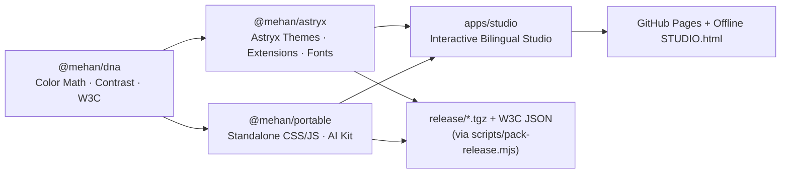

<div align="center">
  <picture>
    <source media="(prefers-color-scheme: dark)" srcset="./assets/readme-header-dark.svg" />
    <source media="(prefers-color-scheme: light)" srcset="./assets/readme-header-light.svg" />
    
  </picture>

  <p>
    <strong>English</strong> · <a href="./README.id.md">Bahasa Indonesia →</a>
    &nbsp;&nbsp;·&nbsp;&nbsp;
    <a href="https://alamehan.github.io/mehan-design-system/"><strong>✨ Open Live Studio</strong></a> ·
    <a href="./STUDIO.html">Offline STUDIO.html</a> ·
    <a href="./LICENSE">MIT License</a>
  </p>
</div>

---

## Why Mehan Design System Exists

Teams building modern digital products often get stuck between two painful choices: spend months building basic buttons, dropdowns, and dialogs from scratch — which look fine in static mockups yet break on keyboard focus, mobile screens, or dark mode — or adopt a generic component kit that feels cold, flat, and identical to everything else.

**Mehan Design System** takes a smarter, craft-driven path. Underneath, it stands directly on **[Meta Astryx](https://astryx.atmeta.com)** — Meta's proven open-source component foundation — so reliability and keyboard accessibility work out of the box from day one. On top of that rock-solid engine, **100% of original Product Design and Engineering care** goes into *how a product actually feels to humans*: warm paper-like surfaces, satisfying tactile buttons, harmonious sizing across every control, 12 ready-made visual moods, and clear bilingual (`EN`/`ID`) UX writing guidance.

---

## Try It Right Now (No Setup Needed)

| What you want to do | Where to go |
|---|---|
| **Explore all 12 visual moods, live components & sample app screens** | Visit **[alamehan.github.io/mehan-design-system](https://alamehan.github.io/mehan-design-system/)** |
| **Open the full interactive Studio offline without internet** | Download and double-click **[`STUDIO.html`](./STUDIO.html)** |
| **Turn an app idea into a working prototype inside Claude, Gemini, or ChatGPT** | Open Studio → click **`Copy AI Kit`** *(or copy [`MEHAN-AI-PROTOTYPE-KIT.md`](./release/MEHAN-AI-PROTOTYPE-KIT.md))* |
| **Standardize another Design System (HRIS, PM, SaaS) on this same architecture** | Read the step-by-step **[Replication Playbook](./docs/DESIGN-SYSTEM-REPLICATION-PLAYBOOK.md)** |

---

## Highlights

- **12 Ready-Made Visual Moods with Automatic Readability:** Switch effortlessly from warm cream *Confectionery* and calm *Kyoto Matcha* to crisp *Porcelain SaaS* or *Obsidian Linear* — every light and dark surface pair is automatically balanced for comfortable reading.
- **Consistent Proportions Across Every Control:** Buttons, inputs, dropdowns, segmented tabs, and custom creative controls share unified heights, corner curves, and text sizes so screens always look calm and aligned.
- **Real Workspace & Creative Building Blocks:** Beyond everyday forms and tables, Mehan includes multi-panel app layouts, interactive stages, charts, color & gradient pickers, code/markdown editors, and auto-saved form drafts.
- **Tune Live, Use Anywhere:** Customize colors, bundled open-source fonts, and corner roundness right inside the live **`Theme Editor`**, then export in one click to **React / Tailwind**, **Vanilla HTML**, **AI Chats**, or **Figma**.
- **Human-First UX & Interface Writing Guide:** Includes a practical 12-chapter bilingual (`EN`/`ID`) guide covering calm layouts, helpful error recovery, and clear button copy for both designers and AI coding agents.

---

## For Developers & Technical Details

<details>
<summary><strong>🛠️ Quickstart, React / Tailwind Setup &amp; CLI Commands</strong></summary>

### 1. React, Next.js, or Vite (`@mehan/astryx` + `@astryxdesign/core`)
Install Meta Astryx from `npm` alongside the pre-packed Mehan release tarball from this repository:

```bash
pnpm add @astryxdesign/core@~0.7.17 @stylexjs/stylex@^0.19.0 lucide-react "https://github.com/alamehan/mehan-design-system/raw/main/release/mehan-astryx-1.0.0.tgz"
pnpm add -D @astryxdesign/cli@~0.7.17 && pnpm exec astryx init --features agents
```

Or scaffold `src/mehan.css` and `src/MehanProvider.tsx` automatically from any Studio JSON export:

```bash
node ./bin/mehan.mjs init ./my-app --from mehan-confectionery-theme.json --github
```

### 2. Vanilla HTML, Vue, Svelte, Astro, or Figma (No React Required)
Grab prebuilt standalone files directly from [`release/`](./release) (or export customized versions from Studio):
- **Standalone CSS & JS:** [`mehan-portable.css`](./release/mehan-portable.css) + [`mehan-portable.js`](./release/mehan-portable.js)
- **Single-Prompt AI Prototype Kit:** [`MEHAN-AI-PROTOTYPE-KIT.md`](./release/MEHAN-AI-PROTOTYPE-KIT.md)
- **Figma W3C Design Tokens:** [`mehan-tokens.w3c.json`](./release/mehan-tokens.w3c.json)

</details>

<details>
<summary><strong>🎨 All 12 Curated Themes, System Architecture &amp; Repository Map</strong></summary>

### Curated Theme Presets

| Theme | Character | Atmosphere | Heading / Body Font | Visual Feel |
|---|---|---|---|---|
| **Confectionery** *(Default)* | Signature Default | `confectionery` | `Bricolage Grotesque` / `Figtree` | Warm cream paper & friendly berry-pink 3D buttons |
| **Espresso Berry** | Tactile Compact | `confectionery` | `Bricolage Grotesque` / `Figtree` | Compact `32px` sizing & bold espresso active tabs |
| **Sunlit Butter** | Warm & Bright | `butter` | `Outfit` / `Outfit` | Sunny buttercream canvas & crisp cobalt buttons |
| **Kyoto Matcha** | Calm & Organic | `matcha` | `Bricolage Grotesque` / `Figtree` | Soft sage-tea paper & deep moss dark mode |
| **Artisanal Cacao** | Editorial Serif | `cacao` | `Fraunces` / `Albert Sans` | Warm oat-latte canvas, roasted cacao & literary serif |
| **Cloud Y2K Pop** | Playful & Soft | `periwinkle` | `Poppins` / `Poppins` | Airy lavender-ice & playful rounded geometry |
| **Obsidian Linear** | Sleek Engineering | `obsidian` | `Albert Sans` / `JetBrains Mono` | Titanium mist & carbon black with crisp corners |
| **Porcelain SaaS** | Clean Enterprise | `porcelain` | `Albert Sans` / `Figtree` | Crisp white & classic blue for data-heavy apps |
| **Stone Editorial** | Quiet Workspace | `stone` | `Fraunces` / `Figtree` | Warm sandstone & calm teal for reading and AI tools |
| **Solar Citrus** | Creative Studio | `butter` | `Bricolage Grotesque` / `Outfit` | Golden warmth paired with vibrant tangerine energy |
| **Nordic Fjord** | Crisp Analytics | `porcelain` | `Montserrat` / `Figtree` | High-clarity porcelain & cool fjord teal for fintech |
| **Velvet Crimson** | Bold Culture | `stone` | `Fraunces` / `Figtree` | Soft alabaster stone paired with rich ruby contrast |

### Monorepo Architecture



| Path | Role |
|---|---|
| [`packages/dna`](./packages/dna) | `@mehan/dna` — Perceptual OKLCH color engine, atmospheres, accents, WCAG 2.2 AA contrast auditor, undo/redo store, `Intl` formatters, and W3C token exporter. |
| [`packages/astryx`](./packages/astryx) | `@mehan/astryx` — Official Meta Astryx theme provider (`createMehanTheme`), prebuilt themes, workspace & creative extensions, runtime hooks, offline WOFF2 fonts, and AI agent docs. |
| [`packages/portable`](./packages/portable) | `@mehan/portable` — Framework-free `.mh-*` CSS generator, progressive JS runtime, AI Prototype Kit generator, and single-HTML starter builder. |
| [`apps/studio`](./apps/studio) | `@mehan/studio` — Interactive bilingual (`EN`/`ID`) Studio organized into `components/`, `views/`, `catalog/`, `templates/`, and `theme-editor/`. |
| [`bin/mehan.mjs`](./bin/mehan.mjs) | Cross-platform project scaffolding & token CLI (`init`, `tokens`, `ai-kit`, `set-scope`). |
| [`scripts/`](./scripts) | [`pack-release.mjs`](./scripts/pack-release.mjs) release bundler plus one-click Windows (`.cmd`) and macOS/Linux (`.command`) launchers. |
| [`release/`](./release) | Pre-packed tarballs (`mehan-dna-1.0.0.tgz`, `mehan-astryx-1.0.0.tgz`, `mehan-portable-1.0.0.tgz`), Portable CSS/JS, AI Kit, CDN HTML, and W3C tokens. |
| [`docs/`](./docs) | **[`DESIGN-SYSTEM-REPLICATION-PLAYBOOK.md`](./docs/DESIGN-SYSTEM-REPLICATION-PLAYBOOK.md)** — Complete blueprint for building sibling domain design systems. |
| [`tests/`](./tests) | [`tests/unit/`](./tests/unit) (Vitest contrast, CLI & repo-hygiene proofs) and [`tests/e2e/`](./tests/e2e) (Playwright visual & `axe` WCAG 2.2 AA suites). |

Run `pnpm install && pnpm verify` *(or double-click [`scripts/verify-windows.cmd`](./scripts/verify-windows.cmd) / [`scripts/verify-mac-linux.command`](./scripts/verify-mac-linux.command))* to run all 6 automated quality gates.

</details>

<details>
<summary><strong>🧭 Design Boundaries, Version Stability &amp; Replication Guide</strong></summary>

- **Pinned Core Stability (`@astryxdesign/core ~0.7.17`):** Versions are pinned intentionally so upstream updates never unexpectedly shift focus behavior or styling; upgrades are tested explicitly via `pnpm verify`.
- **Zero Forked Core Primitives:** Standard controls (`Button`, `Dialog`, `Selector`, `Table`, `Tabs`) stay 100% native Meta Astryx primitives styled through official theme slots (`createMehanTheme.ts`).
- **Separate Sibling Systems for Distinct Domains:** Mehan is crafted for warm web apps, creative studios, and AI workspaces. To standardize high-density enterprise systems with different visual DNA and domain widgets (such as **HRIS**, **Project Management**, or **ERP**), follow **[`docs/DESIGN-SYSTEM-REPLICATION-PLAYBOOK.md`](./docs/DESIGN-SYSTEM-REPLICATION-PLAYBOOK.md)** alongside [`AGENTS.md`](./AGENTS.md) and [`CLAUDE.md`](./CLAUDE.md).

</details>

---

Designed and built with care by **[M. Raihan Rafiiful Allaam (`@alamehan`)](https://alamehan.github.io)** — *Product Designer & Product Engineer*. Released under the [MIT License](./LICENSE) (see [`THIRD_PARTY_NOTICES.md`](./THIRD_PARTY_NOTICES.md)).
