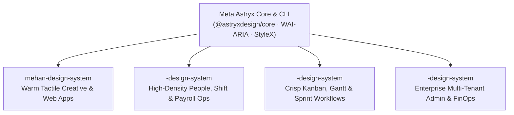

# Design System Replication Playbook (`@alamehan` × Meta Astryx Standard)

> **Self-Contained Blueprint for Future Sessions:** This document preserves the complete architectural strategy, file-by-file cloning map, and ready-to-paste AI kickoff prompt for standardizing any additional `@alamehan` design system (such as **HRIS**, **Project Management**, **Enterprise SaaS**, or **FinOps**) on the **Meta Astryx** engine — requiring **zero prior chat context**.

---

## 1. Architectural Decision: Shared Engine, Separate Domain Repositories

When standardizing multiple design systems with fundamentally different visual characters and domain components (for example, a warm tactile system like **Mehan** vs. a high-density crisp **HRIS** or **Project Management** system), follow the **Shared Engine, Separate Editions** rule:

| Dimension | Shared Across Every `@alamehan` Design System | Unique Per Standalone Design System Repo |
|---|---|---|
| **Core Accessibility Engine** | Official `@astryxdesign/core` + `@astryxdesign/cli` (zero forked core primitives) | Custom slot styling, sizing scale (`28px–36px`), border physics, and focus geometry |
| **Monorepo Anatomy** | `packages/dna`, `packages/astryx`, `packages/portable`, `apps/studio`, `scripts/pack-release.mjs` | Own npm scope (`@<brand>/*`), GitHub repo URL, and `release/*.tgz` tarballs |
| **Distribution Surfaces** | Live GitHub Pages Studio + offline `STUDIO.html` + React/Tailwind + Portable CSS + AI Kit + W3C Figma JSON | Domain-tuned Portable CSS classes and domain-aware AI Prototype Kit templates |
| **Component Layer (`packages/astryx`)** | Universal layout/runtime patterns (`WorkspaceLayout`, `PropertyRow`, `useAutoDraft`, `useMehanShortcuts`) | Domain-specific components (e.g. `ShiftRoster`, `ApprovalStepper`, `KanbanBoard`, `GanttTimeline`) |
| **Showcase Pages (`apps/studio`)** | Interactive catalog, live 3-tier Theme Editor, bilingual (`EN`/`ID`) UX & Maintain tabs | Full-screen domain application templates (e.g. *Payroll Run*, *Org Directory*, *Sprint Board*) |
| **Quality Pipeline** | Mandatory 6-Gate `pnpm verify` (`build` + `typecheck` + `vitest` + `astryx check/verify` + `playwright + axe`) | Contrast matrices and Playwright assertions tailored to the new system's presets and components |

**Why this shines in a Design & Engineering Portfolio:** Every design system you showcase demonstrates institutional consistency (identical rigor, offline `STUDIO.html`体验, AI-agent readiness, and automated WCAG 2.2 AA verification) while proving genuine Product Design range across distinct industries and visual languages.



---

## 2. Three-Bucket Intake Checklist (What You Feed the AI Agent)

Whenever you are ready to turn an existing Figma file, UI kit, or production app design into a standardized Astryx-powered repository, gather your reference materials into three simple buckets:

1. **Bucket A · Core Primitive Styling (Mapped Directly to Astryx Core):**
   - Screenshots or Figma specs of standard controls: Buttons, Inputs, Selectors, Tables, Tabs, Badges, Cards, Modals.
   - Note key physical traits: flat vs. subtle border vs. 3D lip, corner radii (`4px` sharp, `8px` crisp SaaS, `12px` soft, or pill), and default row/control height (`32px` compact enterprise vs. `36px` balanced).
2. **Bucket B · Color Atmospheres, Semantic Statuses & Fonts:**
   - Background paper/card/input surface hexes (Light & Dark), primary brand hexes, and domain status colors (e.g. *Present / Approved / On-Track*, *Pending / At-Risk*, *Overdue / Rejected*, *On-Leave*).
   - Three open-source (OFL) font families for Heading, Body, and Monospace/Tabular numbers.
3. **Bucket C · Custom Domain Components & Flagship App Screens:**
   - List every custom component that goes beyond standard buttons/inputs:
     - **HRIS examples:** `AttendanceCalendar`, `ShiftRosterMatrix`, `ApprovalChain`, `LeaveQuotaCard`, `OrgTree`, `CompensationBreakdown`.
     - **Project Management examples:** `KanbanBoard`, `GanttTimeline`, `IssuePriorityBadge`, `AssigneeAvatarGroup`, `SprintVelocityChart`, `WorkloadBar`.
     - **B2B SaaS examples:** `PermissionMatrix`, `AuditEventStream`, `UsageQuotaMeter`, `WebhookLogViewer`, `TenantSwitcher`.
   - Pick **3 to 5 flagship full-page screens** to build inside Studio's `Templates` tab so visitors and hiring managers can click through realistic live workflows immediately.

---

## 3. Exact 9-Touchpoint Cloning & Transformation Runbook

 Any AI coding agent creating a new design system from this repository must execute these 9 steps in order:

### Step 1 · Clone Clean Workspace & Switch Scope
1. Copy this repository (excluding `node_modules/`, `.git/`, and `release/`) into a new directory (e.g. `hris-design-system`) and run `git init`.
2. Update root [`package.json`](../package.json) (`name`, `description`, `homepage`, and `repository.url` — [`bin/mehan.mjs`](../bin/mehan.mjs) reads `repository.url` dynamically for GitHub tarball install commands).
3. Run the automated scope switcher to rewrite `@mehan/*` across manifests and imports:
   ```bash
   node bin/mehan.mjs set-scope @<new-scope>
   ```
   *(Optionally rename `bin/mehan.mjs` and symbol prefixes like `createMehanTheme` → `create<Brand>Theme` across `packages/` and `apps/studio/`.)*

### Step 2 · Redefine Visual DNA (`packages/dna/src/`)
1. Edit [`packages/dna/src/atmospheres.ts`](../packages/dna/src/atmospheres.ts) with the new neutral surface hierarchies, keeping monotonic dark-mode luminance (`socket < well < paper < tray < surface < raised < float`).
2. Edit [`packages/dna/src/accents.ts`](../packages/dna/src/accents.ts) and [`packages/dna/src/materials.ts`](../packages/dna/src/materials.ts) to set the system's signature corner radii, border/shadow physics (`flat`, `subtle`, or tactile), and default sizing scale.
3. Keep [`packages/dna/src/audit.ts`](../packages/dna/src/audit.ts) and [`packages/dna/src/w3c.ts`](../packages/dna/src/w3c.ts) so every preset mathematically passes **WCAG 2.2 AA** and exports symmetric Light/Dark W3C Figma tokens.

### Step 3 · Bundle Self-Hosted OFL Fonts (`packages/astryx/fonts/` & `fonts.css`)
1. Place `.woff2` font files and their OFL `LICENSE` files inside [`packages/astryx/fonts/`](../packages/astryx/fonts) (see [`packages/astryx/scripts/vendor-fonts.mjs`](../packages/astryx/scripts/vendor-fonts.mjs)).
2. Update [`packages/astryx/fonts.css`](../packages/astryx/fonts.css) so `STUDIO.html` and consuming apps render 100% offline with zero external Google Fonts requests.

### Step 4 · Configure the Meta Astryx Theme Provider (`packages/astryx/src/` & `themes/`)
1. Update [`packages/astryx/src/createMehanTheme.ts`](../packages/astryx/src/createMehanTheme.ts) to map the new DNA tokens onto `@astryxdesign/core` component slots (`button`, `text-input`, `selector`, `table`, `tabs`, `card`, `badge`, `dialog`, `segmented-control`), preserving unified `sm` / `md` / `lg` control heights and proportional font scales.
2. Update prebuilt theme definitions in [`packages/astryx/themes/`](../packages/astryx/themes), [`packages/astryx/scripts/build.mjs`](../packages/astryx/scripts/build.mjs), and [`packages/astryx/package.json`](../packages/astryx/package.json) `"exports"`.

### Step 5 · Build Domain Extension Components & AI Docs (`packages/astryx/`)
1. Follow the **4-Step Extension Ladder** in [`AGENTS.md`](../AGENTS.md): never fork `@astryxdesign/core`; compose or theme Core primitives first, and add custom components in [`packages/astryx/src/components/`](../packages/astryx/src/components) where domain semantics or spatial interactions genuinely require them.
2. Retain universal layout/ergonomic foundations (`WorkspaceLayout`, `PropertyRow`, `DataChart`, `InlineConfirm`, runtime hooks in [`packages/astryx/src/hooks/`](../packages/astryx/src/hooks)), remove unaligned creative-only widgets if out of scope for the domain, and add the new domain components with:
   - Explicit keyboard navigation and `:focus-visible` outlines in [`packages/astryx/src/styles.css`](../packages/astryx/src/styles.css).
   - Matching `.doc.mjs` prop contracts (100% parity with TypeScript props and defaults).
   - Showcase blocks in [`packages/astryx/blocks/`](../packages/astryx/blocks) + exports in [`packages/astryx/package.json`](../packages/astryx/package.json).
   - Updated domain UX & archetype guides in [`packages/astryx/docs/`](../packages/astryx/docs) and [`packages/astryx/astryx.integration.mjs`](../packages/astryx/astryx.integration.mjs).

### Step 6 · Sync Portable CSS & AI Prototype Kit (`packages/portable/`)
1. Update [`packages/portable/src/generator.ts`](../packages/portable/src/generator.ts) so standalone CSS classes and `AI-PROTOTYPE-KIT.md` reflect the new visual physics and include copy-ready HTML patterns for the domain's core layouts and components.

### Step 7 · Customize Interactive Studio (`apps/studio/src/`)
1. Craft a bespoke SVG emblem in [`apps/studio/src/components/`](../apps/studio/src/components) and update creator/system notes in `StudioInfoDialog.tsx`.
2. Define curated domain theme presets in [`apps/studio/src/studioState.ts`](../apps/studio/src/studioState.ts).
3. Update specimen categories in [`apps/studio/src/catalog/`](../apps/studio/src/catalog) and build realistic full-screen domain workflows in [`apps/studio/src/templates/TemplatesView.tsx`](../apps/studio/src/templates/TemplatesView.tsx).

### Step 8 · Generate `@alamehan` Bilingual Documentation
1. Run the `alamehan-readme` skill (or follow [`README.md`](../README.md) / [`README.id.md`](../README.id.md)) to generate Dark & Light `@alamehan · Console` ASCII SVG banners in [`assets/`](../assets), an updated architecture diagram, and 1:1 English + Indonesian READMEs.

### Step 9 · Execute Full 6-Gate Verification (`pnpm verify`)
Run `pnpm verify` and fix every issue until all 6 gates pass cleanly:
1. `pnpm build` — Builds all packages, `apps/studio/dist`, offline `STUDIO.html`, and `release/*.tgz` via [`scripts/pack-release.mjs`](../scripts/pack-release.mjs).
2. `pnpm typecheck` — Strict TypeScript check across packages, Studio, and `tests/tsconfig.json`.
3. `pnpm test:unit` — Vitest contrast math, W3C symmetry, CLI E2E, and repo-hygiene proofs ([`tests/unit/`](../tests/unit)).
4. `pnpm verify:astryx` — Official `astryx integration check --strict --next` + `astryx integration verify` (`0` errors, `0` warnings).
5. `pnpm test:e2e` — Playwright multi-viewport visual & interaction tests + `axe-core` WCAG 2.2 AA contrast audits ([`tests/e2e/`](../tests/e2e)).
6. Manual visual inspection of rendered Playwright screenshots (`1366×900` Light/Dark + `375×812` Mobile).

---

## 4. Ready-to-Copy Master Kickoff Prompt (For Future Fresh Sessions)

Copy the prompt below into a brand-new AI coding session alongside:
1. A reference to this **`mehan-design-system`** repository, and
2. Your Figma screenshots, design tokens, or component list for the new design system.

```markdown
I want to build a brand-new standalone Design System repository standardized on Meta Astryx using `mehan-design-system` as our architectural blueprint.

First, read these files inside `mehan-design-system` in order:
1. `AGENTS.md` and `CLAUDE.md`
2. `docs/DESIGN-SYSTEM-REPLICATION-PLAYBOOK.md` (follow all 9 touchpoints strictly)
3. `packages/astryx/src/createMehanTheme.ts` and `packages/dna/src/`

Target Design System Specification:
- System Name & Repo Slug: [e.g. Karya Design System / karya-design-system]
- NPM Scope: [e.g. @karya]
- Primary Domain: [e.g. Enterprise HRIS, Attendance, Shift Scheduling & Payroll SaaS]
- Visual Character & Density: [e.g. Clean flat/1px-bordered surfaces, crisp 8px corners, 32px–36px data-dense controls, high-clarity status semantics]
- Font Trio (OFL): [Heading / Body / Mono]
- Custom Domain Components to Build in `packages/astryx`: [paste list or attach Figma screenshots]
- Flagship Full-Page Templates for Studio `Templates` Tab: [e.g. 1) Employee & Org Directory, 2) Shift & Leave Roster, 3) Approval Inbox, 4) Payroll Run, 5) HR Analytics]

Before writing code, analyze my attached design references against the 3-Bucket Intake Checklist in `docs/DESIGN-SYSTEM-REPLICATION-PLAYBOOK.md`, present a complete implementation plan, and once approved, execute all 9 steps end-to-end until `pnpm verify` passes all 6 gates (including Playwright Light/Dark/Mobile Visual QA + WCAG 2.2 AA) and bilingual `@alamehan` READMEs (`README.md` + `README.id.md`) are complete.
```
