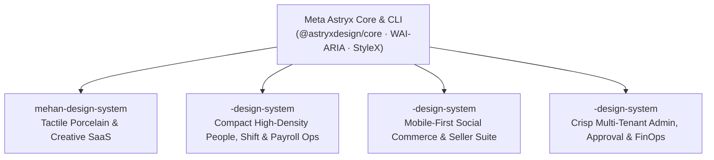

# Design System Replication Playbook (`@alamehan` × Meta Astryx Standard)

> **Zero-Bias Autonomous Replication Blueprint:** This document preserves the complete, self-contained engineering & product design procedure for standardizing **any** standalone design system (such as **Enterprise HRIS**, **Project Management**, **E-Commerce / Social Commerce**, **FinOps / ERP**, **Healthcare**, or **Creative SaaS**) on the **Meta Astryx** engine — requiring **zero prior chat context** and **zero visual bias** from this reference repository.

---

## 1. Core Strategy: Shared Engineering Chassis, Zero Visual Cloning

When turning multiple historical or new design systems into live, self-contained repositories, separate **what is shared** (accessibility rigor, offline single-file `STUDIO.html` + GitHub Pages parity, multi-stack portability, and automated quality gates) from **what must be 100% unique** (surface physics, color atmospheres, typography, density, domain components, and voice):

| Layer | Shared Across Every `@alamehan` Design System Repo | Unique Per Target Design System (Zero Cloning!) |
|---|---|---|
| **Core Accessibility Engine** | Official `@astryxdesign/core` + `@astryxdesign/cli` (zero forked WAI-ARIA primitives) | Target-specific control sizing (`28px–40px`), corner radii, border/elevation physics, & focus rings |
| **Clean Monorepo Layout** | [`packages/dna`](../packages/dna), [`packages/astryx`](../packages/astryx), [`packages/portable`](../packages/portable), [`apps/studio`](../apps/studio), [`scripts/`](../scripts), [`tests/`](../tests) | Own npm scope (`@<scope>/*`), CSS class prefix (`.<prefix>-*`), GitHub URL, & `release/*.tgz` tarballs |
| **5-Way Portability** | Live GitHub Pages Studio + offline [`STUDIO.html`](../STUDIO.html) + React/Tailwind v4 + Portable CSS/JS + AI Kit + W3C Figma JSON | Domain-authentic CSS classes, preset #1 default theme, & domain-specific AI Prototype Kit snippets |
| **Extension Architecture** | 4-Step Extension Ladder (`Reuse Core → Compose → Theme Override → Extend`) + universal workspace/runtime hooks | Domain-native components (e.g., `ShiftRoster`, `KanbanBoard`, `OrderSplitCard`, `ApprovalChain`) |
| **Interactive Studio (`apps/studio`)** | 3-Beat *Playground-First* `Overview`, searchable Catalog, Templates, bilingual (`ID`/`EN`) UX Playbook, Maintain, & `ⓘ` Info/Story Modal | Custom brand emblem SVG, domain full-page templates, & domain UX microcopy rules |
| **6-Gate Verification (`pnpm verify`)** | `build` + `pack-release` → `typecheck` → `vitest` → `astryx check --strict --next` → `playwright` + `axe-core` WCAG 2.2 AA → Visual QA | Contrast matrices, unit locks, and E2E workflows tailored to the target system's presets & components |



### 1.1 Mandatory Anti-Bias Laws (Read Before Writing Any Code!)

1. **Law 1 · Never Clone Mehan’s Surface Physics:** Do **not** carry over 3D bottom button lips, warm confectionery/porcelain tints, or rounded `10px–22px` softness unless the target design system's own Figma/screenshots explicitly use them. Match the target system's authentic material physics:
   - **Crisp Enterprise / HRIS / ERP:** `0px` lip, crisp `1px` structural hairlines, `6px–8px` corners, `32px` high-density rows, tabular numerals.
   - **Architectural FinOps / Editorial:** `0px` lip, high-contrast ink borders, `4px–6px` sharp geometry, authoritative typographic contrast.
   - **Consumer / Super-App / Commerce:** soft ambient shadows, `12px–999px` touch-friendly pills, `36px–40px` controls, expressive status chips.
   - **Tactile Studio / Creative SaaS:** top-lit gradients, physical keycap lips, recessed input wells.
2. **Law 2 · Flagship Default Theme = Preset #1:** Whatever visual theme defines the target product's primary identity (and matches its portfolio showcase) **must** be `DEFAULT_SEED_CONFIG`, Preset `#1` in Studio, the default in `packages/portable`, and the palette of `assets/readme-header-{light,dark}.svg`.
3. **Law 3 · Domain-Authentic Copy & Templates:** Never leave leftover Mehan strings, preset names, or unrelated creative widgets in the cloned repo. Every specimen, template screen, and UX Do/Don't example must speak the target domain's real vocabulary.
4. **Law 4 · Zero External Network Calls at Runtime:** `STUDIO.html` and bundled fonts (`packages/astryx/fonts/*.woff2`) must work 100% offline over `file://` with zero Google Fonts, CDN scripts, or analytics beacons.

### 1.2 Standardized Untangled Repository Layout

Keep the root directory spotless (no loose `.cmd` scripts or duplicate `tsconfig.base.json` files at the root):

```text
<brand>-design-system/
├── .github/workflows/deploy-studio.yml   # Auto-deploys apps/studio to GitHub Pages (+ workflow_dispatch)
├── assets/                               # Adaptive Light/Dark Porcelain/Brand 2.5D README header SVGs
├── apps/studio/                          # Bilingual (ID/EN) Studio -> web dist + single-file STUDIO.html
├── bin/                                  # Consumer project scaffolder CLI (init, tokens, ai-kit, set-scope)
├── docs/DESIGN-SYSTEM-REPLICATION-PLAYBOOK.md
├── packages/
│   ├── dna/                              # Pure OKLCH color/material math, WCAG 2.2 AA auditor, W3C tokens
│   ├── astryx/                           # Meta Astryx theme provider, domain components, WOFF2 fonts, CLI docs
│   └── portable/                         # Standalone CSS/JS generator + single-prompt AI Prototype Kit
├── release/                              # Packed @<scope>/*.tgz tarballs, portable CSS/JS, W3C JSON, AI Kit
├── scripts/                              # pack-release.mjs + OS launchers (dev-* & verify-*)
├── tests/                                # unit/ (Vitest math & repo-hygiene locks) + e2e/ (Playwright + axe)
├── AGENTS.md                             # AI operational contract & 4-Step Extension Ladder
├── CLAUDE.md                             # Architecture map, proportion invariants & 6-gate commands
├── README.md                             # English V3 human-first front door (+ About hook & 1-paste Topics)
├── README.id.md                          # Natural Indonesian V3 front door
├── STUDIO.html                           # 100% offline single-file interactive Studio
└── THIRD_PARTY_NOTICES.md                # Meta Astryx, Lucide, & bundled SIL OFL font attributions
```

---

## 2. Three-Bucket Intake Checklist (What You Feed the AI Agent)

When converting an existing Figma library, production app, or historical design system into this architecture, organize your inputs into three buckets:

1. **Bucket A · Core Primitive Styling & Proportions:**
   - Screenshots or Figma specs of Buttons, Inputs, Selectors, Segmented Controls, Tables, Tabs, Badges, Cards, and Dialogs.
   - Specify border/elevation physics (`flat 1px`, `subtle shadow`, or `tactile lip`), concentric corner radii (e.g., `6px` inner → `8px` control → `12px` card → `18px` dialog), and unified `sm` / `md` / `lg` heights.
2. **Bucket B · Color Atmospheres, Brand Accents & Self-Hosted OFL Fonts:**
   - Neutral surface hierarchy hexes for Light & Dark modes (`socket < well < paper < tray < surface < raised < float`), primary/secondary accents, and semantic statuses (*Success*, *Warning*, *Danger*, *Info*).
   - Open-source SIL OFL font trio (**Heading**, **Body**, **Monospace**) to vendor as `.woff2` files.
3. **Bucket C · Custom Domain Components & Flagship Application Templates:**
   - List custom components beyond `@astryxdesign/core` primitives:
     - *HRIS / People Ops:* `ShiftRosterMatrix`, `AttendanceCalendar`, `ApprovalChain`, `LeaveBalanceCard`, `OrgTree`, `PayrollSummaryStrip`.
     - *Project Management:* `KanbanBoard`, `SprintTimeline`, `PriorityPill`, `WorkloadMeter`, `CycleBurndownChart`.
     - *Commerce / Super-App:* `ProductSkuCard`, `OrderFulfillmentStepper`, `PromoVoucherTicket`, `LiveStockBadge`, `SellerMetricTile`.
     - *Enterprise SaaS / FinOps:* `PermissionMatrix`, `AuditTrailFeed`, `QuotaGauge`, `ReconciliationTable`, `TenantSwitcher`.
   - Choose **3 to 5 full-page domain workflows** for Studio's `Templates` tab so reviewers can experience real product screens immediately.

---

## 3. Exact 10-Touchpoint Replication Runbook

Execute all 10 touchpoints in order when scaffolding a new design system from this blueprint:

### Step 1 · Initialize Clean Workspace, Metadata & Scope
1. Copy this repository (excluding `node_modules/`, `.git/`, `dist/`, and `release/`) into `<brand>-design-system` and run `git init`.
2. Update root [`package.json`](../package.json) (`name`, `description`, `homepage` = `https://<user>.github.io/<repo>/`, and `repository.url` — [`bin/mehan.mjs`](../bin/mehan.mjs) reads `repository.url` dynamically for GitHub tarball install commands).
3. Rewrite package scopes across manifests and imports:
   ```bash
   node bin/mehan.mjs set-scope @<scope>
   ```
   Rename CLI/provider filenames and prefixes (`bin/<brand>.mjs`, `create<Brand>Theme`, `.<prefix>-*` portable classes) so zero legacy naming remains.

### Step 2 · Engineer Authentic Visual DNA (`packages/dna/src/`)
1. Define neutral surface hierarchies in [`packages/dna/src/atmospheres.ts`](../packages/dna/src/atmospheres.ts), preserving strict monotonic dark-mode luminance (`socket < well < paper < tray < surface < raised < float`).
2. Define brand accents and material geometry in [`packages/dna/src/accents.ts`](../packages/dna/src/accents.ts) and [`packages/dna/src/materials.ts`](../packages/dna/src/materials.ts). Set the flagship identity as the default seed.
3. Retain [`packages/dna/src/audit.ts`](../packages/dna/src/audit.ts) and [`packages/dna/src/w3c.ts`](../packages/dna/src/w3c.ts) so **100% of `[Atmosphere × Accent]` combinations pass WCAG 2.2 AA** in Light and Dark modes and export symmetric Light/Dark W3C DTCG Figma tokens.

### Step 3 · Vendor Offline SIL OFL `.woff2` Fonts (`packages/astryx/fonts/`)
1. Vendor `.woff2` font files and license texts into [`packages/astryx/fonts/`](../packages/astryx/fonts) (see [`packages/astryx/scripts/vendor-fonts.mjs`](../packages/astryx/scripts/vendor-fonts.mjs)) and update [`THIRD_PARTY_NOTICES.md`](../THIRD_PARTY_NOTICES.md).
2. Wire `@font-face` declarations in [`packages/astryx/fonts.css`](../packages/astryx/fonts.css) and verify every `url('./fonts/...')` file exists on disk in unit tests.

### Step 4 · Configure Meta Astryx Theme Provider & Proportion Parity (`packages/astryx/`)
1. Map DNA tokens onto `@astryxdesign/core` component slots in [`packages/astryx/src/createMehanTheme.ts`](../packages/astryx/src/createMehanTheme.ts) (renamed to `create<Brand>Theme.ts`), enforcing **strict cross-component scale parity**:
   - Every interactive control (`Button`, `SplitButton`, `IconButton`, `SegmentedControl`, `CopyButton`, `InlineConfirm`, `TextInput`, `Selector`) must share identical `sm` / `md` / `lg` heights, font sizes, and concentric border radii.
   - Inline `<code>` chips scale proportionally (`0.88em`, `line-height: 1.25`).
   - Standalone `<Collapsible>` triggers maintain a `>= 40px` hit target with cushioned inner padding.
   - Every `<Selector>` in Studio passes `placement="below"` for predictable dropdown anchoring.
2. Update prebuilt themes in [`packages/astryx/themes/`](../packages/astryx/themes), [`packages/astryx/scripts/build.mjs`](../packages/astryx/scripts/build.mjs), and [`packages/astryx/package.json`](../packages/astryx/package.json) `"exports"`.

### Step 5 · Build Domain Extension Components & CLI Agent Docs (`packages/astryx/`)
1. Follow the **4-Step Extension Ladder** ([`CLAUDE.md`](../CLAUDE.md)): never fork `@astryxdesign/core`; compose Core primitives first, and build custom domain components in [`packages/astryx/src/components/`](../packages/astryx/src/components) where specialized WAI-ARIA semantics or domain workflows require them.
2. Keep universal layout/ergonomic primitives (`WorkspaceLayout`, `PropertyRow`, `DataChart`, `InlineConfirm`, and hooks in [`packages/astryx/src/hooks/`](../packages/astryx/src/hooks)), prune out-of-scope widgets, and ship each domain component with:
   - Explicit keyboard support and `:focus-visible` rules in [`packages/astryx/src/styles.css`](../packages/astryx/src/styles.css).
   - 1:1 `.doc.mjs` prop documentation + showcase blocks in [`packages/astryx/blocks/`](../packages/astryx/blocks).
   - Domain UX & layout guides in [`packages/astryx/docs/`](../packages/astryx/docs) indexed via [`packages/astryx/astryx.integration.mjs`](../packages/astryx/astryx.integration.mjs).

### Step 6 · Sync Portable CSS, Runtime & AI Prototype Kit (`packages/portable/`)
1. Update [`packages/portable/src/generator.ts`](../packages/portable/src/generator.ts) so standalone CSS classes, progressive JS enhancements, and the single-prompt `AI-PROTOTYPE-KIT.md` reflect the target system's exact visual physics and domain templates (with every `<button>` explicitly carrying `type="button"`).

### Step 7 · Craft the 3-Beat *Playground-First* Studio & `ⓘ` Info Modal (`apps/studio/`)
Structure [`apps/studio/src/App.tsx`](../apps/studio/src/App.tsx), [`apps/studio/src/views/OverviewManifesto.tsx`](../apps/studio/src/views/OverviewManifesto.tsx), and [`apps/studio/src/components/StudioInfoDialog.tsx`](../apps/studio/src/components/StudioInfoDialog.tsx) so `STUDIO.html` is **effortless to scan in 5 seconds yet 100% self-contained**:
1. **Beat 1 · Unified Hero Playground + Integrated Mood Switcher (1 Screen):** Pair a concise 2-line value proposition + live interactive domain control card on top with the 1-click preset switcher docked directly underneath inside `.studio-hero` so switching themes updates the live controls in the same viewport without scrolling or duplicate CTA buttons.
2. **Beat 2 · Open-Canvas Visual Effort Story (Zero Wall of Text):** Float a real side-by-side mini product UI comparison (*Generic Unstyled UI* ➔ *Animated Vector Bridge with Brand Emblem* ➔ *Live Branded UI*) directly on the canvas, flowing into a clean descending **Compression Spine** (4 big WCAG AA numbers + 2–4 word labels only, clickable to jump to `Components` / `UX`).
3. **Beat 3 · 60-Second Multi-Stack Quickstart:** Tabbed 1-click export card (`AI Chat` | `React / Next.js` | `HTML / Vue / Figma W3C`).
4. **Complete `ⓘ` Info & Story Modal (`StudioInfoDialog.tsx`):** House deeper reading (architectural rationale, 6-stage R&D craft story, local-first privacy, keyboard shortcuts, and `@alamehan` creator credits) inside the `ⓘ` modal so zero knowledge is lost while keeping `Overview` uncluttered.
5. Populate [`apps/studio/src/catalog/`](../apps/studio/src/catalog), [`apps/studio/src/templates/TemplatesView.tsx`](../apps/studio/src/templates/TemplatesView.tsx), [`apps/studio/src/views/UxCopyView.tsx`](../apps/studio/src/views/UxCopyView.tsx), and [`apps/studio/src/views/MaintainView.tsx`](../apps/studio/src/views/MaintainView.tsx) with domain-authentic specimens and workflows.

### Step 8 · Configure GitHub Pages Deployment (`.github/workflows/deploy-studio.yml`)
1. Update [`.github/workflows/deploy-studio.yml`](../.github/workflows/deploy-studio.yml) so pushes to `main` (and manual `workflow_dispatch`) build `apps/studio` with `--base=/<repo-slug>/` and publish the live interactive Studio to GitHub Pages alongside the offline [`STUDIO.html`](../STUDIO.html) artifact in the repo root.

### Step 9 · Author V3 Bilingual `@alamehan` Front-Door Documentation
1. Following [`README.md`](../README.md) and [`README.id.md`](../README.id.md) (or the `alamehan-readme` skill):
   - Generate adaptive Light & Dark 2.5D kinetic SVG headers in [`assets/readme-header-light.svg`](../assets/readme-header-light.svg) and [`assets/readme-header-dark.svg`](../assets/readme-header-dark.svg) using **Preset #1's exact palette** and **base64-embedded WOFF2 fonts** (escaped `&amp;` XML entities, zero `<filter>`).
   - Include the copy-ready GitHub **About** 1-sentence hook (`<Emoji> <Hook> — crafted by @alamehan`) + 1-paste space-separated lowercase GitHub **Topics** pills right at the top.
   - Keep main prose warm and human-first, placing CLI/architecture deep dives inside collapsible `<details>` drawers.

### Step 10 · Pass All 6 Automated & Visual Quality Gates (`pnpm verify`)
Run `pnpm verify` and resolve every error before committing:
1. **`pnpm build`** — Compiles `dna`, `astryx`, `portable`, `apps/studio/dist`, offline [`STUDIO.html`](../STUDIO.html), and [`release/`](../release) tarballs via [`scripts/pack-release.mjs`](../scripts/pack-release.mjs).
2. **`pnpm typecheck`** — Zero TypeScript errors across packages, Studio, and [`tests/tsconfig.json`](../tests/tsconfig.json).
3. **`pnpm test:unit`** — Passes all Vitest contrast matrices, W3C token symmetry, CLI E2E, font existence, relative link checks, and zero-hardcoded-path locks ([`tests/unit/repo-and-dna-proof.test.ts`](../tests/unit/repo-and-dna-proof.test.ts)).
4. **`pnpm verify:astryx`** — Passes `astryx integration check --strict --next` + `astryx integration verify` with `0` errors and `0` warnings.
5. **`pnpm test:e2e`** — Passes all Playwright specs + `axe-core` WCAG 2.2 AA audits across Desktop (`1366×900` Light/Dark), `200%` zoom, and Mobile (`375×812` with `0px` horizontal overflow) ([`tests/e2e/`](../tests/e2e)).
6. **Visual QA Inspection** — Render and visually inspect Light, Dark, and Mobile screenshots of `STUDIO.html` and both READMEs before pushing.

---

## 4. Ready-to-Copy Master Kickoff Prompt (For Fresh AI Sessions)

Paste this prompt into any AI coding agent alongside a pointer to `mehan-design-system` and your Figma screenshots / specs for the target design system:

```markdown
I want to create a brand-new, standalone Design System repository standardized on Meta Astryx using `mehan-design-system` strictly as our engineering & structural blueprint (ZERO visual bias).

First, read these files inside `mehan-design-system` in order:
1. `AGENTS.md` and `CLAUDE.md`
2. `docs/DESIGN-SYSTEM-REPLICATION-PLAYBOOK.md` (strictly obey §1.1 Anti-Bias Laws and all 10 touchpoints in §3)
3. `packages/dna/src/`, `packages/astryx/src/`, and `apps/studio/src/`

Target Design System Brief:
- System Name & Repo Slug: [e.g., E-Systems Design System / esystems-design-system]
- NPM Scope & Portable CSS Prefix: [e.g., @esystems / .es-*]
- Primary Domain: [e.g., Enterprise HRIS, Workforce Attendance, Shift Roster & Payroll Suite]
- Authentic Visual Physics (Preset #1 Default): [e.g., Crisp 1px-bordered enterprise surfaces, 0px button lip, 8px control radius, 32px–36px data-dense controls, high-clarity semantic badges]
- Self-Hosted SIL OFL Font Trio: [Heading / Body / Mono]
- Custom Domain Components for `packages/astryx`: [paste list or attach Figma screenshots]
- Flagship Full-Page App Workflows for Studio `Templates` Tab: [3–5 domain screens]

Workflow:
1. Audit my attached references against the 3-Bucket Intake Checklist (§2) and propose an authentic, zero-bias architecture plan (surface hierarchy, Preset #1 + sibling moods, proportion table, domain component roster, and 3-Beat Studio Overview story).
2. Wait for my approval, then execute all 10 touchpoints end-to-end — including offline `STUDIO.html`, `.github/workflows/deploy-studio.yml`, V3 bilingual `README.md` + `README.id.md` (with embedded-font SVG banners, GitHub About hook & 1-paste Topics), and `pnpm verify` passing all 6 gates + Visual QA.
```
